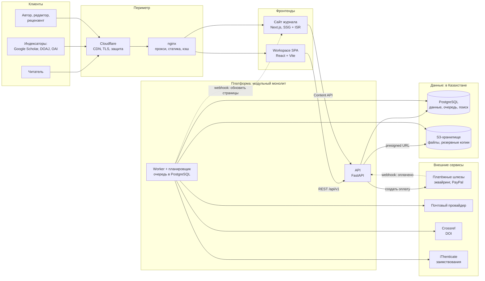
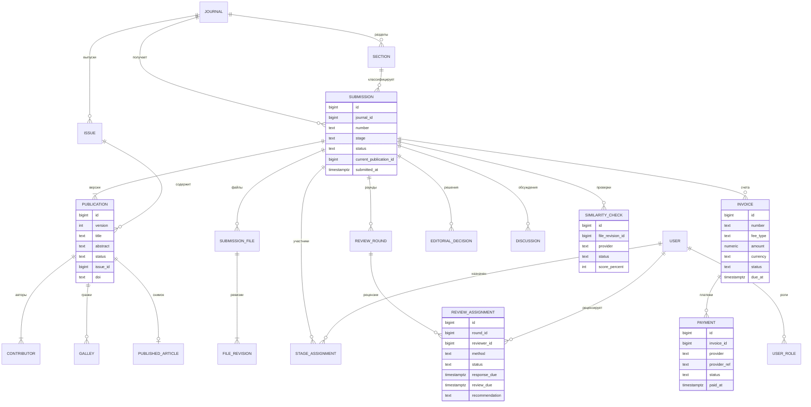
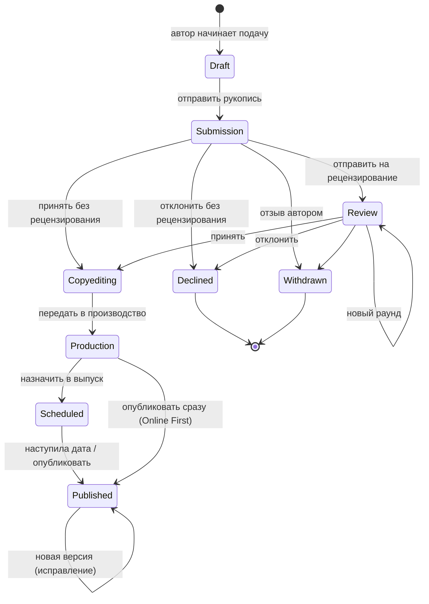
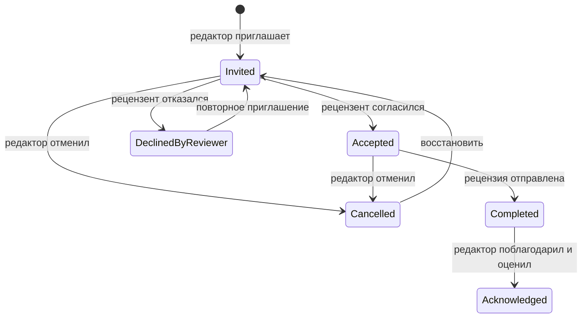
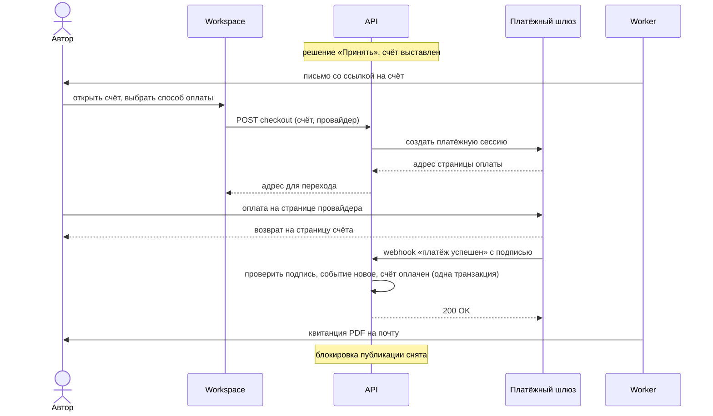
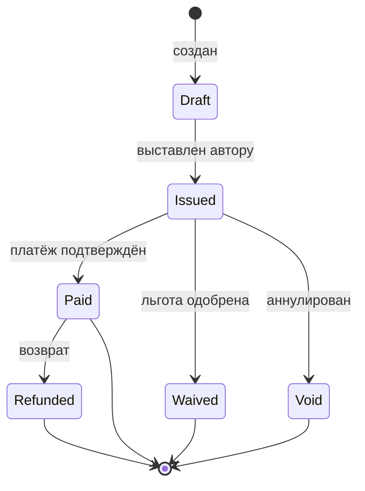
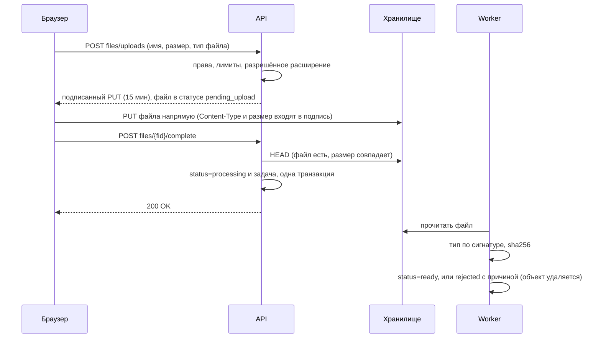
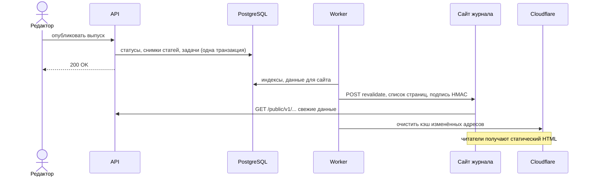

# Архитектура платформы научного журнала

Версия 0.6 · 27.11.2026

Система по образцу Open Journal Systems (OJS): ведёт статью от подачи через рецензирование и редактуру до публикации. Отдельный публичный сайт журнала берёт опубликованные материалы из системы через API.

**Что изменилось в версии 0.6** (по итогам этапа 3):
- **Назначения редакторов** (`Participant`) хранятся в модуле `submissions`, а не в `workflow`: от них зависит, кто видит рукопись, а модуль `submissions` нижний.
- **Слои модулей** проверяет `import-linter`: `workflow` → `review` → `submissions` (§4). Модули выше пользуются нижними, но не наоборот.
- **Шаблоны писем.**
  - Модули регистрируют умолчания, журнал хранит свою редакцию (`email_templates`).
  - Подстановки проверяются при сохранении. Письма рецензентам не предлагают подстановок с именами авторов, поэтому их нельзя добавить и правкой шаблона (§13).
- **Журнал писем** (`email_log`) хранит копии писем по рукописи.
  - Письма учётной записи (сброс пароля, приглашение) с личными ссылками не сохраняются.
  - Если в письмо по рукописи попадает личная ссылка, она заменяется в копии.
- **Анонимные копии для рецензентов** и обезличенные файлы рецензентов (§6.5, §11).
  - Worker удаляет имена из свойств файла DOCX, XLSX, ODT, ODS, PDF и RTF, включая авторов правок и комментариев.
  - Остальные форматы копируются как есть, и редактор видит предупреждение «проверьте файл».
- **Приглашение рецензента сохраняет копию вопросов формы.** Изменение формы не меняет то, о чём уже спросили.
- **Напоминания** отправляет ежечасная задача.
  - Ключ уникальности — (приглашение, вид, смещение, срок): дубликатов нет, а после переноса срока напоминания снова становятся актуальными.
  - Если пропущено несколько напоминаний, отправляется только последнее.
- **Автор видит рецензии раунда после решения редактора** по этому раунду.
- **Ещё не сделано:**
  - уведомления в самом интерфейсе и ежедневный дайджест (сейчас только почта);
  - файлы в обсуждениях;
  - показ рецензентам чужих рецензий после решения;
  - полнотекстовый поиск в подсказке рецензентов (сейчас — совпадение интересов с ключевыми словами и словами аннотации).

**Что изменилось в версии 0.5** (по итогам этапа 2):
- Хранилище файлов — интерфейс с двумя реализациями (§11):
  - S3 — обязательна в production;
  - локальный диск с подписанными ссылками — для разработки и демонстраций.
- Загрузка файла: запросить ссылку → `PUT` в хранилище → подтвердить (§10, §11). Worker проверяет содержимое по сигнатуре и считает sha256. Антивирус, извлечение текста и анонимная копия для рецензентов пока не сделаны:
  - анонимная копия понадобится для рецензирования (этап 3);
  - антивирус (ClamAV) — к запуску (этап 7).
- У фоновых задач появился обработчик «сдаться» (§12). Он вызывается после последней неудачной попытки и переводит запись в понятное состояние. Без него проверка, которую не удалось выполнить, или непроверенный файл навсегда висели бы «в процессе».
- Номер рукописи (`JRN-2026-0001`) присваивается при отправке атомарным счётчиком на журнал и год. Префикс задаётся в настройках подачи.
- Настройки подачи хранятся в настройках журнала:
  - чек-лист;
  - требования к авторам;
  - лимиты;
  - префикс номера;
  - проверка на заимствования.

**Что изменилось в версии 0.4** (по итогам этапа 1):
- Очередь фоновых задач — своя, на таблице PostgreSQL, вместо библиотеки Procrastinate (решение 4 в §3). Задача добавляется в той же транзакции SQLAlchemy, что и бизнес-изменение, без второго драйвера БД.
- Компоненты для локального запуска — `compose.yaml` в корне репозитория, конфигурация nginx — в `deploy/` (§20).

**Что изменилось в версии 0.3** (журнал регистрируется в Казахстане):
- Сервер, база данных, файлы и резервные копии размещаются в Казахстане. Этого требует статья 12 закона РК «О персональных данных и их защите» (§17, §19).
- Карты принимаются через казахстанский интернет-эквайринг. Stripe для казахстанских компаний не подтверждён; PayPal нужно подтвердить при открытии счёта (§8.2).
- Плата одна: за публикацию, после принятия статьи.
- Журнал новый. Импорт архива не нужен; ISSN, Crossref и домен оформляются параллельно с разработкой (§22, §23).

**Что изменилось в версии 0.2:**
- Один язык — английский. Многоязычные поля убраны.
- Один журнал. Задел на несколько журналов оставлен в схеме данных, но интерфейс и адреса рассчитаны на один.
- Недорогой VPS. Убран Redis, файлы и резервные копии вынесены в отдельное S3-хранилище. Добавлена оценка стоимости (§19.3).
- DOI (Crossref), проверка на заимствования и платежи входят в первую версию. Добавлены разделы §6.7, §8, §9.
- Журнал реальный. Добавлены риски и внешние зависимости (§22).

---

## 1. Цели и рамки

### 1.1 Из чего состоит решение

| Часть | Для кого | Что делает |
|---|---|---|
| **Платформа** (бэкенд + рабочее пространство редакции) | авторы, редакторы, рецензенты, менеджер журнала, финансовый менеджер | подача рукописей, проверка на заимствования, рецензирование, решения, оплата, редактура, вёрстка, выпуски, публикация, DOI |
| **Сайт журнала** (отдельное приложение) | читатели, поисковики, индексаторы | выпуски, статьи, правила для авторов, редколлегия, поиск; только читает опубликованное |

### 1.2 Исходные решения заказчика

| Вопрос | Решение | Следствие для архитектуры |
|---|---|---|
| Язык | английский | интерфейс и метаданные на одном языке; обычные текстовые поля |
| Количество журналов | один (пока) | адреса без кода журнала; `journal_id` в таблицах сохранён, чтобы второй журнал не требовал переделки |
| Страна | Казахстан | данные хранятся в Казахстане; платежи идут через местный эквайринг |
| Размещение | VPS, недорого | один сервер в казахстанском дата-центре, Docker Compose; минимум сервисов |
| Интеграции в первой версии | DOI, антиплагиат, оплата картой, PayPal и другими способами | модули `payments`, `similarity`, интеграция с Crossref |
| Назначение | реальный журнал | резервные копии, безопасность, доставляемость писем, юридические требования — с первого дня |
| Оплата | только за публикацию, после принятия статьи | один вид счёта |
| Статус журнала | новый; ISSN, членства в Crossref и домена пока нет | до их получения система работает без DOI и антиплагиата; домен — настройка |

### 1.3 Функциональный объём

**Первая версия:**
- Учётные записи и роли, разделы журнала.
- Подача рукописи: пошаговый мастер, метаданные, соавторы, файлы, чек-лист требований, согласие с политиками.
- Проверка на заимствования через внешний сервис, отчёт виден только редакции.
- Редакционный процесс: этапы **Подача → Рецензирование → Редактура → Производство → Публикация**, назначение участников, решения редактора.
- Рецензирование: раунды, приглашения, сроки, автоматические напоминания, настраиваемые формы рецензии, двойное слепое / одинарное слепое / открытое рецензирование, подсказка рецензентов.
- Оплата публикации: счета, несколько способов оплаты (карта через эквайринг, PayPal при доступности, банковский перевод), льготы, квитанции, возвраты.
- Обсуждения внутри этапов, уведомления (почта и в системе), редактируемые шаблоны писем.
- Выпуски (том, номер, год), публикация статей, версии публикации, гранки (PDF, HTML).
- DOI: присвоение и регистрация в Crossref.
- Публичный Content API для сайта журнала, OAI-PMH, метатеги для Google Scholar.
- Журнал аудита всех действий.

**Следующие версии:**
- Вход и привязка через ORCID (в первой версии ORCID — поле в профиле).
- Статистика просмотров и скачиваний.
- Экспорт в JATS XML и DOAJ.
- Импорт архива выпусков, если журнал уже выходит.
- Второй и следующие журналы.

### 1.4 Нефункциональные требования

Это цели проектирования. Их подтверждают нагрузочные тесты (§16.3) перед запуском.

| Показатель | Цель |
|---|---|
| Страница статьи на сайте журнала, время до первого байта (из CDN) | < 100 мс |
| Чтение через API редакции, p95 | < 150 мс |
| Запись (решение, отправка рецензии), p95 | < 300 мс; письма уходят в фоне и время ответа не увеличивают |
| Загрузка файла до 50 МБ | идёт напрямую в хранилище, сервер API в передаче не участвует |
| Доступность | 99,5 % на одном сервере; сайт журнала остаётся доступен из CDN при сбое сервера |
| Ёмкость сервера 2 vCPU / 4 ГБ | один журнал: до ~2 тыс. рукописей в год и ~300 тыс. просмотров страниц в месяц |
| Восстановление после потери сервера | до 4 часов, потеря данных не более 5 минут |

---

## 2. Общая схема



Файлы браузер загружает и скачивает напрямую из S3 по одноразовым ссылкам, которые выдаёт API (§11).

| Контейнер | Технология | Ответственность |
|---|---|---|
| **API** | Python 3.13, FastAPI, SQLAlchemy 2 (async), asyncpg, Pydantic v2 | вся бизнес-логика, права, REST API, приём вебхуков |
| **Worker** | тот же код, своя очередь задач на PostgreSQL | фоновые и периодические задачи: письма, файлы, напоминания, DOI, антиплагиат, счета, обновление сайта |
| **Workspace SPA** | React, TypeScript, Vite, TanStack Query | интерфейс редакции: кабинеты автора, редактора, рецензента, менеджера, финансов |
| **Сайт журнала** | Next.js (App Router), TypeScript | публичный сайт; страницы генерируются статически и обновляются по событию |
| **PostgreSQL** | 17+ | единственный источник истины: данные, очередь задач, полнотекстовый поиск, сессии |
| **S3-хранилище** | S3-совместимое хранилище казахстанского провайдера | файлы рукописей (приватно), опубликованные гранки (публично), резервные копии БД |
| **nginx** | — | маршрутизация, статика, микрокэш публичного API, ограничение частоты запросов |
| **Cloudflare** | бесплатный тариф | CDN, TLS, DNS, защита от DDoS; кэширует только опубликованное |

**Где лежат данные.** Сервер и S3-хранилище находятся в дата-центре в Казахстане (§17). За рубежом остаются только кэш опубликованных страниц в CDN и внешние сервисы, которым данные передаются с согласия пользователя.

Домены (пример):
- `journal.org` — сайт журнала.
- `editorial.journal.org` — рабочее пространство (`/`), API редакции (`/api`), публичный API (`/public`), OAI-PMH (`/oai`), вебхуки (`/webhooks`). SPA и API на одном домене, поэтому не нужны CORS и сторонние cookie.
- `files.journal.org` — опубликованные файлы из хранилища.

---

## 3. Ключевые архитектурные решения

| # | Решение | Почему | Когда пересматривать |
|---|---|---|---|
| 1 | **Модульный монолит**: один код, два процесса (API и worker), модули с жёсткими границами | Домен связный: рукопись проходит через все модули, решения должны быть атомарными. Микросервисы добавили бы задержки, распределённые транзакции и сложную эксплуатацию, а одному журналу не дали бы ничего | Модуль, который явно перерос остальные, выносится в сервис: модули общаются через интерфейсы и события |
| 2 | **Python + FastAPI + async SQLAlchemy** | Узкое место — ввод-вывод (БД, файлы, внешние сервисы), а не CPU. Pydantic v2 быстро валидирует и сериализует. OpenAPI-схема генерируется автоматически → типизированный клиент для обоих фронтендов. Сильная экосистема для PDF, DOCX, XML | Только если профилирование покажет упор в CPU самого API |
| 3 | **PostgreSQL — единственное хранилище состояния**: данные, очередь задач, поиск, сессии | Меньше сервисов → дешевле сервер, проще резервное копирование и восстановление. Транзакции охватывают всё | Отдельный поисковый движок или Redis — при росте (§16.2) |
| 4 | **Своя очередь задач на таблице PostgreSQL** (`app/core/jobs.py`) | Задача ставится в **той же транзакции**, что и бизнес-изменение: нет «потерянных» писем и писем о решении, которое откатилось. Worker забирает задачи через `FOR UPDATE SKIP LOCKED`, повторяет с растущей задержкой, возвращает задачи упавшего процесса, запускает периодические задачи. Около 250 строк кода, без второго драйвера БД | При сотнях задач в секунду — очередь на Redis или RabbitMQ |
| 5 | **Без Redis в первой версии** | Для одного журнала он не нужен: сессии — в PostgreSQL (один запрос по индексу), кэш публичного API — в nginx и CDN, ограничение частоты — в nginx | Появляется при втором экземпляре API или нескольких журналах |
| 6 | **Файлы в S3-хранилище по presigned URL** | Браузер работает с хранилищем напрямую; на сервере нет состояния, кроме БД; диск VPS не растёт. Опубликованные гранки раздаёт CDN | — |
| 7 | **Отдельный сайт журнала: статическая генерация + обновление по событию** | Читателей на порядки больше, чем редакторов, а страницы статей меняются редко. Сайт отдаёт страницы из CDN, даже если сервер недоступен. Хорошо для SEO | — |
| 8 | **Витрина опубликованного (read model)** | При публикации собирается готовый снимок статьи (JSONB). Публичный API читает его одной строкой по ключу, читатели не нагружают редакционные таблицы | — |
| 9 | **Права = роль + назначение на рукопись + правила объекта**; анонимизация — в одном слое сериализации | Модель OJS, проверенная практикой. Одна точка контроля того, кто что видит | — |
| 10 | **Платежи через размещённые страницы оплаты провайдеров** и единый интерфейс адаптеров | Данные карт не попадают на наш сервер, поэтому требования PCI DSS минимальны. Новый способ оплаты — новый адаптер, остальной код не меняется | — |
| 11 | **Оплата отделена от редакционного решения** | Счёт выставляется только после принятия статьи. Редакторы и рецензенты не видят статус оплаты и заявки на льготу до решения. Это требование этики публикаций и индексаторов | — |
| 12 | **Внешние сервисы за интерфейсами**: антиплагиат, платежи, DOI, почта | Провайдера можно заменить без переделки системы. Это важно: доступность провайдеров зависит от страны и статуса журнала (§22) | — |
| 13 | **Один язык и один журнал, но без тупиков** | Текстовые поля вместо многоязычных; `journal_id` сохранён во всех таблицах. Добавление журнала или языка — доработка, а не переписывание | — |
| 14 | **REST + OpenAPI 3.1**, ошибки в формате RFC 9457, курсорная пагинация | Клиентов два, оба наши; REST проще кэшировать | — |
| 15 | **Серверные сессии в httpOnly-cookie** | Сессию можно отозвать; токен в браузере нельзя украсть через XSS | — |
| 16 | **Персональные данные хранятся в Казахстане**: база, файлы, резервные копии | Требование статьи 12 закона РК «О персональных данных и их защите». Передача за рубеж (почта, Crossref, антиплагиат, CDN) — с согласия пользователя по статье 16 | При изменении закона или юрисдикции журнала |

---

## 4. Модули бэкенда

| Модуль | Ответственность | Основные сущности |
|---|---|---|
| `identity` | пользователи, вход, сессии, 2FA, профиль, научные интересы | User, Session, ApiToken |
| `journals` | настройки журнала, разделы, роли, политики, шаблоны писем, страницы и объявления для сайта | Journal, Section, UserRole, EmailTemplate, Page, Announcement |
| `submissions` | подача, метаданные, авторы, версии публикации | Submission, Publication, Contributor |
| `workflow` | этапы, переходы, решения, участники, обсуждения | StageAssignment, EditorialDecision, Discussion, Message |
| `review` | раунды, приглашения рецензентов, формы рецензий, подсказка рецензентов | ReviewRound, ReviewAssignment, ReviewForm |
| `similarity` | проверка на заимствования через внешнего провайдера | SimilarityCheck |
| `payments` | тарифы, счета, платежи, возвраты, льготы, сверка | FeeSchedule, Invoice, Payment, Refund, WaiverRequest, ProviderEvent |
| `files` | файлы рукописей и их ревизии, доступ, проверка, обработка | SubmissionFile, FileRevision |
| `publishing` | выпуски, гранки, расписание, витрина опубликованного, DOI | Issue, Galley, PublishedArticle, DoiDeposit |
| `notifications` | письма, уведомления в системе, дайджесты | Notification, EmailLog |
| `search` | индексация и поиск для редакции и читателей | поля `tsvector` в таблицах |
| `integrations` | Crossref, OAI-PMH; позже ORCID и экспорт | — |
| `audit` | неизменяемый журнал действий | AuditEvent |

Кроме модулей есть **ядро** (`core`): конфигурация, подключение к БД, хранилище, очередь, безопасность.

**Устройство модуля** (одинаковое для всех):

```
modules/review/
  models.py      # таблицы (SQLAlchemy)
  schemas.py     # входные и выходные DTO (Pydantic)
  service.py     # сценарии: invite, accept, submit_review…; здесь транзакции
  policies.py    # кто что может делать и что видит (анонимизация)
  repository.py  # запросы к БД
  router.py      # HTTP-эндпоинты
  events.py      # события модуля
```

Модули с внешними провайдерами (`payments`, `similarity`) дополнительно содержат `providers/`: общий интерфейс и по файлу на адаптер.

**Правила границ:**
1. Модуль пишет только в свои таблицы. Чужие данные меняются только вызовом сервиса другого модуля.
2. HTTP-слой тонкий: разбирает запрос → вызывает сервис → сериализует через политику.
3. Побочные эффекты (письма, индексация, обновление сайта, DOI, счета) — через **доменные события**. Сервис ставит их в очередь в той же транзакции; обработчики работают в worker. Примеры: `SubmissionSubmitted`, `ReviewCompleted`, `DecisionRecorded`, `InvoicePaid`, `IssuePublished`.
4. Зависимости между модулями проверяются линтером импортов (`import-linter`) в CI.

---

## 5. Модель данных



**Основные принципы:**

- **Один журнал, с заделом.** Во всех таблицах журнала есть `journal_id`, он заполняется автоматически. Второй журнал добавляется без изменения схемы.
- **Один язык.** Название, аннотация, ключевые слова — обычные текстовые поля. Поиск работает с английским словарём.
- **Рукопись и публикация разделены**, как в OJS 3.2+:
  - `Submission` — «дело» в редакции: этап, статус, участники, история.
  - `Publication` — версия метаданных и текста (v1, v2…). Опубликованная версия неизменяема; исправление после публикации — новая версия, старая остаётся доступной.
- **Этап и статус — разные поля.**
  - `stage`: `submission | review | copyediting | production`.
  - `status`: `draft | queued | scheduled | published | declined | withdrawn`.
- **Оплата — не этап.** Счёт живёт рядом с рукописью и только блокирует публикацию, пока не оплачен (§8).
- **Файлы неизменяемы.** Новая загрузка создаёт `FileRevision` (ключ в хранилище, размер, sha256, MIME). `SubmissionFile.file_stage` указывает, к чему относится файл: подача, файл для рецензентов, вложение рецензии, исправленная версия, отредактированный текст, файл для вёрстки, гранка.
- **Деньги** хранятся как `numeric` плюс код валюты, без чисел с плавающей точкой.
- **Аудит** — только добавление, таблица секционирована по месяцам.
- **Идентификаторы.**
  - Внутри — `bigint identity`.
  - Наружу — номер рукописи (`JRN-2026-0042`), номер счёта (`INV-2026-0017`), человекочитаемый адрес статьи.
  - Ключи файлов — UUIDv7, их невозможно угадать.
- **Время** — `timestamptz` в UTC.
- **Оптимистичная блокировка.** Редактируемые сущности (метаданные, настройки) имеют поле `version`, клиент отправляет его в `If-Match`. Два редактора не затрут правки друг друга.

**Ключевые индексы** (под реальные списки в интерфейсе):

| Запрос | Индекс |
|---|---|
| Очередь редакции по статусу и этапу | `submissions (journal_id, status, stage, updated_at DESC)` |
| «Мои рукописи» участника | `stage_assignments (user_id, submission_id)` |
| «Мои рецензии» | `review_assignments (reviewer_id, status)` |
| Просроченные рецензии (для напоминаний) | частичный: `review_assignments (review_due) WHERE status IN ('invited','accepted')` |
| Неоплаченные счета | частичный: `invoices (due_at) WHERE status = 'issued'` |
| Повторные вебхуки провайдеров | `provider_events (provider, event_id)` UNIQUE |
| Статья на сайте | `published_articles (journal_id, slug)` UNIQUE |
| Поиск | GIN по `search_vector`, GIN `pg_trgm` по именам авторов |

---

## 6. Редакционный процесс

### 6.1 Этапы и переходы



Все допустимые переходы описаны **одной таблицей** в коде (`workflow/transitions.py`). Любое изменение этапа или статуса идёт через неё. Каждое решение атомарно делает следующее:
1. Создаёт запись `EditorialDecision`.
2. Меняет этап или статус.
3. При выходе из рецензирования отменяет незавершённые приглашения рецензентов.
4. Пишет аудит.
5. Ставит в очередь письмо автору. Редактор видит письмо по шаблону и может отредактировать его перед отправкой.
6. При решении «Принять» ставит в очередь выставление счёта, если публикация платная (§8).

**Условие публикации:** переходы в «Запланирована» и «Опубликована» разрешены, только если счёт за публикацию оплачен, снят льготой или плата не предусмотрена.

### 6.2 Решения редактора

| Этап | Решение | Результат |
|---|---|---|
| Подача | Отправить на рецензирование | создаётся раунд 1, этап «Рецензирование» |
| Подача | Принять без рецензирования | этап «Редактура» |
| Подача | Отклонить (desk reject) | статус «Отклонена» |
| Рецензирование | Запросить исправления | автор загружает исправленную версию **в тот же раунд**, повторного рецензирования нет |
| Рецензирование | Отправить на повторное рецензирование | автор исправляет → **новый раунд** с рецензентами |
| Рецензирование | Принять | этап «Редактура»; выставляется счёт |
| Рецензирование | Отклонить | статус «Отклонена» |
| Любой | Рекомендовать решение | рекомендация ответственному редактору; доступно редактору раздела с правом «только рекомендация» |
| Редактура | Передать в производство | этап «Производство» |
| Производство | Назначить в выпуск / опубликовать | «Запланирована» / «Опубликована» (при выполнении условия оплаты) |
| До публикации | Вернуть на предыдущий этап | откат с обязательной записью причины в аудит |

### 6.3 Участники этапов

| Этап | Кто работает | Что происходит |
|---|---|---|
| Подача | автор, главный редактор, редактор раздела | проверка соответствия требованиям и отчёта о заимствованиях, назначение ответственного редактора |
| Рецензирование | редактор, рецензенты, автор (исправления) | приглашения, рецензии, решения, раунды |
| Редактура | литературный редактор, автор, редактор | правка текста, согласование правок с автором через обсуждения |
| Производство | верстальщик, корректор, автор, редактор | гранки PDF/HTML, корректура, назначение в выпуск |

### 6.4 Жизненный цикл рецензии



- **Сроки:** срок ответа на приглашение и срок рецензии задаются при приглашении (умолчания — в настройках журнала).
- **Просрочка** — вычисляемый признак, а не статус.
- **Напоминания** — периодическая задача. Смещения настраиваются, например: за 3 дня до срока, в день срока, через 3 и 7 дней после. Каждое напоминание фиксируется, повторов не бывает.
- **Форма рецензии** — конструктор вопросов. Ответы хранятся в JSONB. Комментарии делятся на видимые автору и только для редактора.
- **Оценка рецензента.** Редактор оценивает рецензию от 1 до 5, оценка учитывается в подсказке рецензентов.

### 6.5 Слепое рецензирование: кто что видит

| Данные | Автор | Рецензент (двойное слепое) | Рецензент (одинарное слепое) | Рецензент (открытое) | Редактор |
|---|---|---|---|---|---|
| Имена и аффилиации авторов | да | **нет** | да | да | да |
| Имя рецензента | **нет** (кроме открытого) | своё | своё | своё | да |
| Комментарии рецензента для редактора | нет | свои | свои | свои | да |
| Рекомендация рецензента | нет | своя | своя | своя | да |
| Рецензии других рецензентов | нет | нет (по настройке — после решения) | то же | то же | да |
| Сопроводительное письмо автора | да | нет | да | да | да |
| Отчёт о заимствованиях | нет | нет | нет | нет | да |
| Счета и заявки на льготу | свои | нет | нет | нет | нет до решения (§8.5) |

Как это обеспечивается:
1. **Единый слой сериализации:** каждый ответ API собирается через `policies.py` с учётом того, кто смотрит. Скрываемые поля просто не попадают в ответ.
2. **Подготовка файлов:** worker снимает метаданные автора (свойства DOCX и PDF) с копий, которые видят рецензенты.
3. **Шаблоны писем рецензентам** без имён авторов.
4. **Нумерация рецензентов:** автор видит «Reviewer 1, 2…», номер одного рецензента постоянен между раундами.
5. **Конфликт интересов:** автор рукописи никогда не получает к ней редакторского доступа, даже если у него есть роль редактора.

### 6.6 Подсказка рецензентов

1. **Кандидаты** — пользователи с ролью рецензента.
2. **Исключаются:** авторы рукописи (по email и ORCID), её редакторы, уже приглашённые в этом раунде, заявившие конфликт интересов.
3. **Предупреждения:** та же организация, что у авторов; отказ в прошлом раунде.
4. **Ранжирование:**
   - совпадение ключевых слов рукописи с интересами рецензента (полнотекстовое сходство);
   - история: средний срок рецензии, доля отказов, оценка редакторов;
   - минус текущая нагрузка (число открытых рецензий).
5. **Позже:** смысловое сопоставление аннотаций через эмбеддинги (`pgvector`), без смены архитектуры.

### 6.7 Проверка на заимствования

- **Когда.** Автоматически после отправки рукописи (настраивается). Для исправленных версий — по кнопке редактора. Каждая проверка платная, поэтому по умолчанию — одна на рукопись.
- **Как.** Worker отправляет основной файл провайдеру, получает идентификатор, затем результат (вебхук провайдера или опрос). Состояния: `queued → processing → completed | failed`, с повторами при сбоях.
- **Что видит редактор.** Общий процент совпадений, крупнейшие источники, ссылку на полный отчёт на стороне провайдера (ссылка короткоживущая, выдаётся по запросу).
- **Порог.** Настраиваемый процент помечает рукопись флагом «требует внимания». Автоматического отклонения нет: решение принимает редактор.
- **Доступ.** Только редакция. Авторы и рецензенты отчёт не видят.
- **Провайдеры.** Интерфейс `SimilarityProvider` (`submit`, `get_result`, `get_report_url`):
  - основной — **Crossref Similarity Check** (iThenticate);
  - запасной — прямой договор с iThenticate или другой сервис с API. Запасной вариант нужен из-за условий допуска (§22).

---

## 7. Роли и права

| Роль | Возможности |
|---|---|
| Администратор (менеджер журнала) | настройки журнала, пользователи и роли, разделы, шаблоны писем, формы рецензий, выпуски, страницы сайта, тарифы; полный доступ к рукописям |
| Главный редактор | все рукописи, назначение редакторов, решения |
| Редактор раздела | рукописи, на которые назначен; можно ограничить правом «только рекомендация» |
| Рецензент | только свои приглашения и рецензии |
| Автор | свои рукописи: подача, исправления, обсуждения, согласование правок, свои счета |
| Литературный редактор, верстальщик, корректор | только этапы рукописей, на которые назначены |
| Финансовый менеджер | тарифы, счета, платежи, возвраты, заявки на льготу, сверка; без доступа к рецензиям |

**Как проверяется доступ** (одна функция `authorize()`, вызывается сервисом):
1. Сессия → пользователь и его роли (один запрос по индексу).
2. Роль даёт **возможности** (`submission.decide`, `invoice.refund`, `journal.settings.edit`, …).
3. Для действий над рукописью нужно **назначение на неё на этом этапе**. Исключение — администратор и главный редактор: у них доступ неявный.
4. **Правила объекта:** состояние позволяет действие (нельзя отправить рецензию по отменённому приглашению). Это проверяет машина состояний.
5. **Проекция ответа** с учётом анонимности (§6.5).

---

## 8. Платежи

### 8.1 Что оплачивается

Плата одна: **за публикацию (APC)**. Счёт выставляется автоматически после решения «Принять» и блокирует публикацию статьи, пока не оплачен или не снят льготой.

Тариф настраивается в интерфейсе (`FeeSchedule`): сумма, валюта, к каким разделам или типам статей применяется. Валюта счёта одна и задаётся в настройках журнала. Какие валюты доступны, зависит от договора с банком-эквайером.

### 8.2 Способы оплаты

Каждый способ — адаптер с общим интерфейсом `PaymentProvider` (`create_checkout`, `parse_webhook`, `refund`). Журнал регистрируется в Казахстане, поэтому набор такой:

| Адаптер | Что даёт | Статус |
|---|---|---|
| **Казахстанский интернет-эквайринг** | карты Visa и Mastercard, включая иностранные | основной способ; провайдера выбирает редакция |
| **PayPal** | оплата со счёта PayPal и картой через PayPal | по документации PayPal Казахстан входит в страны с приёмом и выводом средств; сторонние обзоры расходятся, поэтому это нужно подтвердить при открытии бизнес-счёта |
| **Банковский перевод** | счёт с реквизитами для организаций и авторов без карты | работает всегда; оплату подтверждает финансовый менеджер |
| **Kaspi Pay** (по желанию) | привычная оплата для авторов из Казахстана | добавляется отдельным адаптером |

**Кандидаты на эквайринг.** Все заявляют приём Visa и Mastercard; точные ставки определяет договор.

| Провайдер | Что известно из открытых источников |
|---|---|
| Halyk ePay | Visa, Mastercard, American Express; опубликованный тариф: карты других банков 3 %, American Express 4 % |
| TipTop Pay | комиссия от 2,5 %; заявлен приём платежей в 37 валютах |
| Freedom Pay | по обзорам, принимает зарубежные карты; тарифы не публикует |

**Критерии выбора эквайера:**
- принимает карты, выпущенные за рубежом;
- поддерживает нужную валюту счёта;
- страница оплаты на стороне провайдера;
- уведомления об оплате с подписью;
- возвраты через API;
- тестовая среда для разработки.

**Stripe** не планируется: поддержка прямых счетов для казахстанских компаний не подтверждена. Если она появится, адаптер добавляется без изменения остального кода.

### 8.3 Как проходит оплата



Правила надёжности:
- **Источник истины — вебхук**, а не возврат автора на сайт: автор может закрыть вкладку.
- **Подпись вебхука проверяется** секретом провайдера.
- **Идемпотентность:** идентификатор события провайдера уникален в `provider_events`. Повторная доставка ничего не меняет.
- **Сверка:** ежедневная задача сравнивает платежи у провайдеров со счетами и сообщает о расхождениях финансовому менеджеру.
- **Данные карт** на наш сервер не попадают: оплата идёт на странице провайдера.

### 8.4 Счёт и его состояния



- **Счёт** содержит номер, плательщика (человек или организация, адрес, налоговый номер), сумму, скидку, налог, срок оплаты. PDF формирует worker.
- **Частичная льгота** — скидка в счёте; полная — состояние `Waived`.
- **Возврат** — через API провайдера, полный или частичный, с записью причины.
- **Просрочка** — вычисляемый признак; напоминания отправляет периодическая задача.
- **Налоги и чеки** — ставка НДС и реквизиты задаются в настройках. Нужен ли фискальный чек при оплате картой от физического лица, решает бухгалтер. Если нужен, фискализация подключается через эквайера или отдельным адаптером (§22).

### 8.5 Независимость редакционных решений

1. Плата за публикацию выставляется **только после** решения о принятии.
2. Автор может запросить льготу при подаче. Заявку рассматривает финансовый менеджер, а не редактор рукописи.
3. Редакторы и рецензенты **не видят** статус оплаты и заявки на льготу до решения. После принятия редактор видит только признак «можно публиковать / нельзя».
4. Политика оплаты и льгот публикуется на сайте журнала.

---

## 9. DOI и Crossref

- **Префикс** журнал получает при вступлении в Crossref. Шаблон суффикса настраивается, например `10.xxxxx/jrn.2026.0042`.
- **Присвоение.** DOI резервируется при переходе в производство, чтобы попасть в гранки. Регистрируется при публикации.
- **Регистрация.** Worker формирует XML по схеме Crossref и отправляет его в Crossref. В XML входят:
  - метаданные статьи, авторы с ORCID, аннотация, лицензия;
  - список литературы;
  - ссылки на полный текст (нужны и для допуска к Similarity Check).
- **Контроль.** Каждая отправка записывается в `DoiDeposit` (состояние, ответ Crossref). Ошибки видны администратору, отправку можно повторить.
- **Обновления.** Новая версия статьи или изменение адреса вызывают повторную отправку метаданных.

---

## 10. API

| Поверхность | Путь | Клиенты | Авторизация | Кэширование |
|---|---|---|---|---|
| Workspace API | `/api/v1/…` | рабочее пространство, скрипты | cookie-сессия; токены API для интеграций | приватное; ETag |
| Public Content API | `/public/v1/…` | сайт журнала, сторонние сервисы | нет; ограничение частоты | микрокэш nginx + `Cache-Control: s-maxage, stale-while-revalidate` + CDN |
| OAI-PMH | `/oai` | харвестеры, индексаторы | нет | микрокэш nginx |
| Входящие вебхуки | `/webhooks/{provider}` | платёжные шлюзы, антиплагиат | подпись провайдера | — |
| Исходящие вебхуки | → сайт журнала | обновление страниц | подпись HMAC | — |

**Соглашения:**
- Ошибки — `application/problem+json` (RFC 9457).
- Списки — курсорная пагинация `?cursor=…&limit=…`.
- Создающие запросы, которые клиент может повторить, принимают `Idempotency-Key`.
- Правки — `If-Match` с версией (§5).
- Все даты — ISO 8601 в UTC.
- Журнал определяется из контекста запроса (сейчас он один), в путях его нет.

**Основные эндпоинты Workspace API:**

```
POST   /api/v1/auth/login | /logout          GET /api/v1/me
GET    /api/v1/submissions                              # мои рукописи (автор)
GET    /api/v1/submissions/editorial?status=&section_id=&q=   # очередь редакции
POST   /api/v1/submissions                              # черновик
PATCH  /api/v1/submissions/{id}/publication             # метаданные (If-Match)
POST   /api/v1/submissions/{id}/contributors            # соавторы; PUT …/contributors/order
POST   /api/v1/submissions/{id}/submit
POST   /api/v1/submissions/{id}/files/uploads           # подписанная ссылка на PUT
POST   /api/v1/submissions/{id}/files/{fid}/complete    # подтвердить загрузку
GET    /api/v1/submissions/{id}/files/{fid}/download    # 302 на подписанную ссылку
POST   /api/v1/submissions/{id}/similarity-checks       # запустить проверку
GET    /api/v1/submissions/{id}/similarity-checks/{cid}/report   # 302 на отчёт провайдера
GET|PUT /api/v1/journal/submission-settings             # настройки подачи (If-Match)
GET    /api/v1/submissions/{id}/workflow                # этап, решения, раунды, обсуждения — как видит смотрящий
POST   /api/v1/submissions/{id}/decisions/preview       # письмо автору и файлы для рецензентов до решения
POST   /api/v1/submissions/{id}/decisions               # решение или рекомендация + письмо
POST   /api/v1/submissions/{id}/withdraw                # отзыв автором
POST   /api/v1/submissions/{id}/editors | DELETE …/editors/{uid}   # редакторы рукописи
GET    /api/v1/submissions/{id}/review-rounds           # раунды: редакции — всё, автору — рецензии после решения
GET    /api/v1/submissions/{id}/review-rounds/{rid}/suggestions?q=  # подсказка рецензентов
POST   /api/v1/submissions/{id}/review-rounds/{rid}/invitation-preview
POST   /api/v1/submissions/{id}/review-rounds/{rid}/reviewers       # пригласить рецензента
POST   /api/v1/submissions/{id}/review-assignments/{aid}/cancel | /remind | /acknowledge
POST   /api/v1/submissions/{id}/review-rounds/{rid}/revisions/uploads | …/submit   # исправления автора
GET    /api/v1/reviews                                  # мои рецензии
GET    /api/v1/reviews/{aid}                            # рукопись так, как её может видеть рецензент
POST   /api/v1/reviews/{aid}/accept | /decline | /submit;  PUT …/draft
POST   /api/v1/submissions/{id}/discussions             # и …/discussions/{did}/messages
GET    /api/v1/submissions/{id}/emails                  # журнал писем (редакция)
GET|PUT /api/v1/journal/review-settings;  /journal/review-forms;  /journal/email-templates/{key}
GET    /api/v1/submissions/{id}/invoices
POST   /api/v1/invoices/{id}/checkout                   # начать оплату
POST   /api/v1/invoices/{id}/mark-paid | /refund | /void    # финансы
POST   /api/v1/submissions/{id}/waiver-request
POST   /api/v1/waiver-requests/{id}/decide              # финансы
POST   /api/v1/issues
POST   /api/v1/publications/{pid}/schedule | /publish | /new-version
POST   /api/v1/publications/{pid}/doi/deposit           # повторить регистрацию DOI
```

**Публичный API** (только опубликованное, только чтение):

```
GET  /public/v1/journal                    # название, описание, ISSN, редколлегия, тарифы
GET  /public/v1/issues                     # архив
GET  /public/v1/issues/current
GET  /public/v1/issues/{volume}/{number}
GET  /public/v1/articles/{slug}            # снимок статьи из витрины
GET  /public/v1/search?q=
GET  /public/v1/pages/{slug}               # «About», «For authors», политики
GET  /public/v1/announcements
```

Из OpenAPI-схемы генерируется TypeScript-клиент (`packages/api-client`). Его используют оба фронтенда, поэтому типы на фронте и бэке не расходятся.

---

## 11. Файлы



- **Реализации хранилища** (`app/core/storage.py`, выбирается настройкой `JPS_STORAGE_BACKEND`):
  - **S3** — подписанные ссылки boto3; обязательна в production;
  - **локальный диск** — для разработки и демонстраций:
    - API сам выдаёт ссылки на `/api/v1/storage/{token}`, подписанные HMAC;
    - срок действия ссылки, ключ, тип и размер файла входят в подпись.
- **Хранилище:**
  - приватный бакет: `journals/{journal_id}/submissions/{submission_id}/{uuid}.{ext}`;
  - публичный бакет: только гранки опубликованных статей, раздаются через CDN;
  - бакет резервных копий: отдельные ключи доступа;
  - все бакеты размещены в Казахстане.
- **Скачивание приватных файлов:** API проверяет права → выдаёт presigned GET на 5 минут с исходным именем файла.
- **Снятие с публикации:** файл удаляется из публичного бакета, кэш CDN очищается.
- **Ограничения** (настройки журнала): максимальный размер (по умолчанию 50 МБ), разрешённые типы.
- **Брошенные загрузки** (не подтверждённые за сутки) удаляет задача, которая запускается каждые 6 часов.
- **Удаление** (черновика или файла): объекты удаляются фоновой задачей после коммита транзакции. Сбой хранилища не откатывает изменения в базе.

---

## 12. Фоновые задачи и события

Механизм — своя очередь на таблице `jobs` в PostgreSQL (`app/core/jobs.py`). Бизнес-транзакция записывает данные и ставит задачи атомарно. Worker выполняет задачи с повторами и экспоненциальной задержкой. Упавшие задачи видны администратору, их можно перезапустить.

Задача может объявить обработчик `on_give_up`. Он вызывается один раз, когда исчерпана последняя попытка, и переводит запись в понятное состояние. Например, проверка на заимствования становится «failed» с причиной, а файл — «rejected» с просьбой загрузить его снова.

Каждая точка входа (API, worker, миграции) импортирует `app.models` целиком: без этого связи между таблицами не разрешатся. Это проверяет тест.

| Задача | Когда |
|---|---|
| `send_email` | любое уведомление |
| `process_uploaded_file` | подтверждение загрузки |
| `run_similarity_check`, `poll_similarity_result` | отправка рукописи, запрос редактора |
| `issue_invoice`, `render_invoice_pdf` | решение «Принять» |
| `invoice_reminders` | раз в сутки |
| `reconcile_payments` | раз в сутки |
| `review.send_reminders` | раз в час |
| `files.prepare_review_copy` | файлы для рецензентов: копия без имён в свойствах |
| `publish_scheduled` | раз в минуту: публикует выпуски и статьи с наступившей датой |
| `build_published_snapshot` | публикация, новая версия |
| `crossref_deposit`, `crossref_check_status` | публикация, новая версия |
| `revalidate_journal_site` | публикация, изменение выпуска, страниц, настроек журнала |
| `backup_database` | раз в сутки (плюс непрерывный архив WAL) |
| `cleanup_abandoned_uploads` | каждые 6 часов |
| `delete_objects` | удаление черновика или файла (после коммита) |

---

## 13. Уведомления и письма

- **Шаблоны писем** с переменными (`{recipientName}`, `{submissionTitle}`, `{reviewDueDate}`, `{invoiceUrl}`, …). Администратор редактирует их в интерфейсе.
- **Письма о решениях** редактор видит заранее и может отредактировать перед отправкой.
- **Уведомления в системе** и по почте. Пользователь выбирает: сразу или ежедневный дайджест.
- **Доставка:** через почтового провайдера (SMTP или API), с повторами при ошибках. Журнал отправленных писем (`EmailLog`) доступен редакции.
- **Доставляемость:** для домена журнала настраиваются SPF, DKIM и DMARC. Без них приглашения рецензентам будут попадать в спам.

---

## 14. Поиск

- **Редакция:** поиск рукописей по номеру, названию, авторам, ключевым словам. Полнотекстовый поиск PostgreSQL (`tsvector` с английским словарём, GIN) и `pg_trgm` для имён и частичных совпадений.
- **Читатели:** тот же механизм по витрине опубликованного. Вектор поиска строится при сборке снимка.
- **Рост:** модуль `search` скрывает реализацию за интерфейсом. Отдельный поисковый движок подключается без изменения остального кода.

---

## 15. Сайт журнала

Отдельное приложение на **Next.js** (App Router, TypeScript). Работает только через публичный API. Оформление задаётся дизайн-токенами.

**Как отдаются страницы:**
- Все страницы опубликованного генерируются **статически**. При публикации или изменении платформа присылает вебхук, и Next.js **пересобирает только затронутые страницы** (on-demand ISR).
- Читатель получает готовый HTML из CDN. Если сервер недоступен, сайт продолжает работать на последней версии страниц.

**Страницы:**
- главная: текущий выпуск, объявления;
- архив выпусков, страница выпуска;
- **страница статьи:**
  - аннотация, авторы с ORCID, ключевые слова, список литературы;
  - DOI, лицензия, версии, даты получения, принятия и публикации;
  - скачивание PDF или просмотр HTML;
  - «How to cite»: APA, MLA, Chicago, Harvard, Vancouver, BibTeX, RIS;
- «About», цели и тематика, редколлегия, политики (рецензирование, этика, лицензия, оплата и льготы), правила для авторов. Тексты ведутся в платформе;
- поиск, объявления;
- «Submit» — переход в рабочее пространство (регистрация или вход) с возвратом.

**Индексация:**
- Метатеги `citation_*` (формат Highwire Press), которые требует Google Scholar.
- Dublin Core, JSON-LD `schema.org/ScholarlyArticle`.
- `sitemap.xml`, канонические адреса, RSS/Atom.
- OAI-PMH отдаёт платформа.



---

## 16. Производительность

### 16.1 Где может тормозить и что с этим делаем

| Узкое место | Решение |
|---|---|
| Трафик читателей | статические страницы + CDN; публичный API читает готовый снимок одной строкой по ключу; микрокэш nginx с отдачей устаревшей копии на время обновления; ETag/304 |
| Большие файлы | presigned-загрузка и скачивание напрямую из S3; опубликованное — через CDN |
| Медленные операции (почта, PDF, Crossref, антиплагиат) | в фоне; пользователь получает ответ сразу |
| Внешние сервисы недоступны | вызовы только из worker, с повторами; интерфейс редакции от них не зависит |
| Запросы к БД | индексы под каждый список (§5); keyset-пагинация вместо OFFSET; связи без N+1 (`selectinload`); в списках только нужные колонки; пул соединений asyncpg |
| Дашборды редакции | счётчики по статусам — один `GROUP BY` по индексу |
| Сериализация | Pydantic v2 + orjson |
| Интерфейс редакции | разделение кода по маршрутам; статика с вечным кэшем (хеш в имени файла); TanStack Query: клиентский кэш, фоновое обновление, оптимистичные обновления |
| Память сервера (4 ГБ) | нет Redis и своего хранилища файлов; PostgreSQL настроен под 1 ГБ; 2 процесса API |

### 16.2 Путь роста

API и worker не хранят состояния. Рост идёт по шагам, каждый следующий — только когда метрики покажут необходимость:
1. Увеличить VPS (4 vCPU, 8 ГБ) — минуты простоя.
2. Вынести PostgreSQL на отдельный сервер или управляемую БД.
3. Добавить второй экземпляр API и Redis (общий кэш, ограничение частоты).
4. Добавить реплику PostgreSQL для поиска и статистики.

### 16.3 Проверка

- Нагрузочные сценарии на k6:
  - читатели на публичном API;
  - дашборд редактора;
  - подача рукописи;
  - отправка рецензии.
- Цели из §1.4 — порог прохождения перед запуском.
- Медленные запросы ловит `pg_stat_statements`.

---

## 17. Безопасность

- **Пароли:** Argon2id.
- **Двухфакторная аутентификация (TOTP):** по желанию; для администратора и финансового менеджера её можно сделать обязательной.
- **Сессии:**
  - cookie `HttpOnly; Secure; SameSite=Lax`;
  - хранятся на сервере → отзыв при выходе и блокировке;
  - защита от CSRF: токен в заголовке для изменяющих запросов.
- **Ограничение частоты:** nginx (`limit_req`) для входа, регистрации, сброса пароля и публичного API; блокировка учётной записи после серии неудачных входов.
- **Платежи:**
  - данные карт обрабатывает провайдер, на наш сервер они не попадают;
  - подпись каждого вебхука проверяется;
  - суммы берутся из счёта на сервере, а не из запроса браузера;
  - все финансовые действия записываются в аудит.
- **Загрузки:**
  - белый список типов и проверка по сигнатуре, а не по расширению;
  - антивирус ClamAV — по желанию (требует ~1 ГБ памяти, то есть VPS на 8 ГБ);
  - файлы никогда не отдаются с домена приложения.
- **Секреты** (ключи провайдеров, хранилища, почты) — в переменных окружения сервера, не в репозитории.
- **Аудит:** решения, назначения, смены ролей, доступ к файлам рецензий, финансовые операции.
- **Персональные данные:**
  - база, файлы и резервные копии хранятся в Казахстане (статья 12 закона РК «О персональных данных и их защите»);
  - при регистрации пользователь даёт согласие на обработку данных и на их передачу за рубеж: редакторам и рецензентам из других стран, в Crossref, сервису проверки на заимствования, почтовому провайдеру, CDN (статья 16);
  - выгрузка и удаление аккаунта; в опубликованных материалах имя остаётся, учётная запись обезличивается;
  - у международного журнала будут авторы из ЕС, поэтому требования GDPR учитываются сразу;
  - в сервис учёта ошибок персональные данные не отправляются.
- **Заголовки безопасности в nginx:** CSP, HSTS, `X-Content-Type-Options`.
- **Проверка зависимостей** на уязвимости в CI.

---

## 18. Наблюдаемость

**Первая версия (без отдельных серверов мониторинга):**
- **Логи** — структурированные (JSON), с `request_id` сквозь API и worker.
- **Ошибки** — Sentry (бесплатный тариф), без персональных данных в событиях.
- **Доступность** — внешний сервис проверки сайта, API и вебхуков с оповещением.
- **Эндпоинты** `/health` и `/ready`.
- **Оповещения из самой системы** администратору:
  - упавшие задачи;
  - неудачная регистрация DOI;
  - расхождение при сверке платежей;
  - неудачная резервная копия;
  - заканчивается место на диске.

**Позже:** метрики Prometheus и трассировки OpenTelemetry.

---

## 19. Развёртывание и стоимость

### 19.1 Состав сервера

Один VPS в казахстанском дата-центре: **2 vCPU, 4 ГБ ОЗУ, 40–80 ГБ SSD**, Docker Compose.

```
nginx  ─┬─ workspace     (статика)
        ├─ api           (2 процесса uvicorn)
        └─ journal-site  (Next.js standalone)
worker  (очередь задач и расписание)
postgres
```

Вне сервера: S3-хранилище (в Казахстане), Cloudflare (CDN, DNS, TLS), почтовый провайдер, Sentry.

### 19.2 Выпуск и резервные копии

- **Окружения:** `dev` (Compose локально) и `prod`. Отдельный `staging` — на том же сервере под другим доменом или по мере необходимости.
- **CI:** линтеры → проверка типов → тесты → сборка образов → миграции Alembic → выкладка.
- **Резервные копии PostgreSQL:**
  - непрерывный архив WAL и ежедневная полная копия в отдельный бакет S3;
  - можно восстановить состояние на любой момент за последние 14 дней.
- **Файлы** уже лежат в облачном хранилище; в бакетах включено версионирование.
- **Проверочное восстановление** — раз в месяц, по записанной инструкции.

### 19.3 Оценка стоимости

Цены ориентировочные, на ноябрь 2026 года, из открытых источников разной надёжности. Перед заказом их нужно сверить на сайтах провайдеров.

**Инфраструктура, в месяц:**

| Статья | Оценка | Комментарий |
|---|---|---|
| VPS 2 vCPU / 4 ГБ в Казахстане | ≈ 7 600–12 400 ₸ | по данным агрегаторов; цены конкретных провайдеров не подтверждены |
| S3-хранилище в Казахстане | ≈ 100–300 ₸ | 8,5–12 ₸ за ГБ в месяц (Cloupard, PS.kz, Yandex Cloud kz1); расчёт на 10–20 ГБ |
| CDN, DNS, TLS (Cloudflare) | 0 | бесплатный тариф |
| Почтовый провайдер | $0–15 | объём писем небольшой |
| Мониторинг (Sentry, проверка доступности) | 0 | бесплатные тарифы |
| **Итого** | **≈ 8 000–13 000 ₸ и до $15** | плюс домен |

**Внешние сервисы:**

| Статья | Оценка | Комментарий |
|---|---|---|
| Членство в Crossref | $200–275 в год | $200 — при доходе или расходах на издание до $999 в год, $275 — до $1 млн |
| Регистрация DOI | ~$1 за статью | по неофициальным данным; сверить на crossref.org/fees |
| Similarity Check (iThenticate через Crossref) | годовой сбор + плата за документ | по неофициальным данным: сбор ~20 % от членского взноса, первые 100 документов в год бесплатно, далее ~$0,75 за документ |
| Интернет-эквайринг | около 2,5–3 % с платежа | American Express — до 4 %; точная ставка в договоре |
| PayPal | комиссия с платежа | по тарифам PayPal для Казахстана; не проверялась |

---

## 20. Структура репозитория

```
journal-platform/
├── backend/
│   ├── app/
│   │   ├── core/              # конфигурация, БД, хранилище, очередь, безопасность
│   │   ├── modules/
│   │   │   ├── identity/
│   │   │   ├── journals/
│   │   │   ├── submissions/
│   │   │   ├── workflow/
│   │   │   ├── review/
│   │   │   ├── similarity/    # providers/: crossref_ithenticate.py, …
│   │   │   ├── payments/      # providers/: acquirer.py, paypal.py, bank_transfer.py
│   │   │   ├── files/
│   │   │   ├── publishing/
│   │   │   ├── notifications/
│   │   │   ├── search/
│   │   │   ├── integrations/  # crossref, oai
│   │   │   └── audit/
│   │   ├── api/               # сборка роутеров: workspace, public, oai, webhooks
│   │   ├── main.py            # приложение API
│   │   └── worker.py          # процесс worker
│   ├── migrations/            # Alembic
│   └── tests/
├── workspace/                 # React + Vite: рабочее пространство редакции
├── journal-site/              # Next.js: сайт журнала
├── packages/
│   └── api-client/            # TypeScript-клиент, генерируется из OpenAPI
├── deploy/                    # nginx, развёртывание на сервере, резервные копии
├── docs/                      # архитектура, диаграммы
├── compose.yaml               # всё приложение локально в Docker
└── .github/workflows/         # CI: проверки бэкенда, фронтенда и схемы API
```

---

## 21. План реализации

| Этап | Содержание | Результат |
|---|---|---|
| 1. Каркас | репозиторий, Docker Compose, БД и миграции, ядро, вход и сессии, настройки журнала, разделы, роли, CI | можно войти, настроить журнал, назначить роли |
| 2. Подача | мастер подачи, метаданные, соавторы, загрузка файлов через S3, проверка на заимствования (интерфейс и тестовый провайдер) | автор подаёт рукопись |
| 3. Редакционный процесс | этапы и решения, назначения, рецензирование (раунды, формы, напоминания, анонимность, подсказка рецензентов), обсуждения, письма | рукопись проходит путь до принятия |
| 4. Платежи | тарифы, счета, интернет-эквайринг (на тестовой среде провайдера), PayPal, банковский перевод, льготы, квитанции, возвраты, сверка, блокировка публикации | принятая статья оплачивается |
| 5. Производство и публикация | редактура, гранки, выпуски, версии, витрина, публичный API, OAI-PMH, DOI и Crossref | статья публикуется с DOI |
| 6. Сайт журнала | Next.js, страницы, обновление по вебхуку, SEO, «How to cite» | работающий публичный сайт |
| 7. Запуск | боевые ключи провайдеров, нагрузочные тесты, проверка безопасности, резервные копии и проверочное восстановление, инструкции, развёртывание на VPS | система в эксплуатации |

Этапы 1–3 выполнены.

Этапы 1–3 не зависят от внешних договоров. Регистрацию журнала, договор с эквайером и вступление в Crossref стоит начать параллельно с разработкой: они занимают время (§22).

---

## 22. Риски и внешние зависимости

| Риск | Что это значит | Что делаем |
|---|---|---|
| **Хранение данных в Казахстане** | закон требует хранить персональные данные в базе на территории Казахстана; передача за рубеж допускается с согласия пользователя | сервер и S3-хранилище у казахстанского провайдера; согласия при регистрации; тексты согласий и политику конфиденциальности проверяет юрист |
| **Договор с эквайером** | интернет-эквайринг подключается к юридическому лицу со счётом и проходит проверку банка; это занимает от дней до недель. Приём PayPal в Казахстане нужно подтвердить | переговоры с банком начать сразу после регистрации юрлица; до этого разработка идёт на тестовой среде провайдера; банковский перевод работает всегда |
| **Фискальные чеки и НДС** | при оплате картой от физического лица может требоваться фискальный чек; правила НДС на плату за публикацию зависят от режима налогообложения | поля и настройки для этого есть; порядок определяет бухгалтер до этапа 4 |
| **Вступление в Crossref** | без членства нет префикса DOI; заявка рассматривается не мгновенно | подать заявку после регистрации журнала; до получения префикса система работает без DOI |
| **Допуск к Similarity Check** | сервис доступен только членам Crossref с опубликованными статьями, у которых есть DOI и ссылки на полный текст. Новому журналу он на старте недоступен | проверка включается настройкой; до допуска — запасной провайдер через тот же интерфейс или работа без проверки |
| **Письма попадают в спам** | у нового домена нет репутации | SPF, DKIM, DMARC с первого дня; надёжный почтовый провайдер |
| **Один сервер** | отказ сервера останавливает редакцию | сайт журнала остаётся доступен из CDN; резервные копии вне сервера; восстановление по инструкции до 4 часов |
| **Требования индексаторов** | DOAJ, Scopus и другие проверяют политики, редколлегию, архивирование, историю публикаций | система даёт всё техническое: постоянные адреса, DOI, лицензии, OAI-PMH, страницы политик. Тексты политик и договоры об архивировании — задача редакции |

---

## 23. Что нужно от редакции

Вопросов, которые блокируют разработку, нет. Параллельно с ней редакции нужно сделать следующее:

1. **Зарегистрировать журнал:** юридическое лицо и счёт в банке, ISSN.
2. **Выбрать эквайера** по критериям из §8.2 и заключить договор. Открыть бизнес-счёт PayPal и проверить, что приём платежей доступен.
3. **Подать заявку в Crossref** на членство и префикс DOI.
4. **Купить домен.** До этого система работает на временном адресе.
5. **Проконсультироваться с юристом и бухгалтером:** согласия на обработку и передачу данных за рубеж, НДС, фискальные чеки.
6. **Определить сумму и валюту платы за публикацию.** Это настройка, решение можно принять перед запуском.

Хостинг в Казахстане выбирается на этапе 7; к нему будет подготовлено сравнение провайдеров с актуальными ценами.

---

## Источники

- [Закон РК «О персональных данных и их защите», статьи 12 и 16 (adilet.zan.kz)](https://adilet.zan.kz/rus/docs/Z1300000094)
- [PayPal: страны и поддерживаемые возможности](https://developer.paypal.com/payouts/supported-features)
- [Stripe: страны, где доступен сервис](https://stripe.com/global)
- [Halyk Bank: интернет-эквайринг ePay](https://halykbank.kz/index.php/en/business/payment/epay)
- [TipTop Pay: тарифы](https://tiptoppay.kz/tarify)
- [Сравнение платёжных шлюзов Казахстана (raem.kz)](https://raem.kz/sravnenie-platezhnyh-shlyuzov-i-internet-ekvajringa-v-kazahstane-gajd-dlya-it-i-e-commerce/)
- [PS.kz: тарифы облачных сервисов](https://www.ps.kz/ru/news/new-tariff-2025)
- [Cloupard: объектное хранилище S3](https://cloupard.kz/s3)
- [Yandex Cloud: тарификация Object Storage](https://yandex.cloud/ru/docs/storage/pricing)
- [Казахстанские VPS: сравнение тарифов (hosters.ru)](https://hosters.ru/deshevyi-kazakhskyi-vps.html)
- [Crossref: Fees](https://www.crossref.org/fees/)
- [Crossref: новый тариф членства $200 с января 2026](https://community.crossref.org/t/some-things-are-big-because-they-are-small-the-new-fee-tier-for-crossref-members-takes-effect-crossref/14936)
- [Crossref: Similarity Check](https://www.crossref.org/services/similarity-check/)
- [Similarity Check: тарифы за документ (сторонний обзор)](https://maqtoob.com/tool/crossref-similarity-check/)
- [Стоимость DOI в 2026 году (сторонний обзор)](https://pubscience.org/blog/how-much-does-a-doi-cost)
